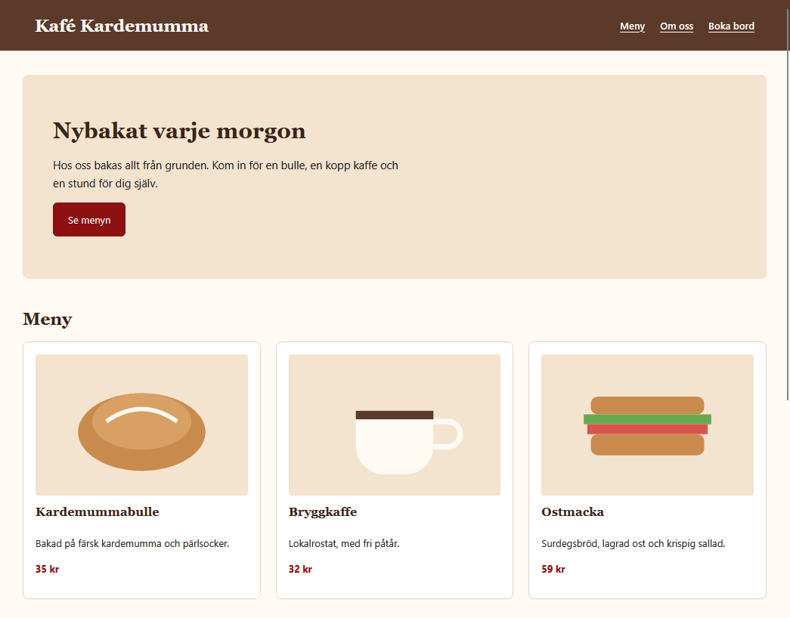

# Dag 10 · GitHub och publicering

_Modul 4, UI/UX & Frontendutveckling, Lexicon IT-Proffs_

## Varför

Detta är en del i utbildningen UI/UX & Frontendutvekling som är 
en arbetsmarknadsutbildning. Jag går den för att skaffa mig ny 
kunskap och nya färdigheter. 

## Test site

Det går att se denna site på följande länk :
(https://winstrand.github.io/martin-m4-dag10-github-och-publicering/)[https://winstrand.github.io/martin-m4-dag10-github-och-publicering/]

Site thumbprint: 

## Utveklare

Utveklare av denna branch: Martin Winstrand Erfaren systemutvecklare och projektledare med bred bakgrund inom IT, utveckling, IT-drift och informationssäkerhet. Jag har nyligen påbörjat en utbildning inom UX/UI, med fokus på användarupplevelse, användarcentrerad design och moderna gränssnitt. Min tekniska erfarenhet i kombination med UX/UI ger mig ett helhetsperspektiv på hur digitala lösningar kan bli både tekniskt välfungerande och användarvänliga. Jag är strukturerad, lösningsorienterad och trivs med att samarbeta med människor och verksamheter.
